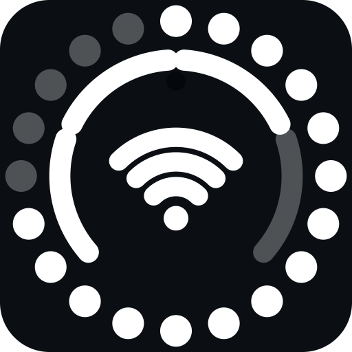

# Ring of Android

[](https://github.com/tastoprak/Ring-of-Android/actions/workflows/build.yml)

**Kamera deliğinin etrafına pil, şebeke ve Wi-Fi durumunu çizen yüzen bir halka.**
iPhone'daki "Dynamic Island" fikrinin Android'deki sade yorumu: bildirim çubuğunu açmadan,
ekranın üstündeki deliğin çevresinde durum bilgisini gösterir.



> Görsel, `RingView`'in çizim kodundaki aynı parametrelerle üretildi (kaynak: `docs/ring-onizleme.svg`): pil %75, şebeke 3/4, Wi-Fi 3/3.
> Telefonda görünen uygulama adı **Island**'dır; depo/proje adı Ring of Android.

## Ne gösteriyor

| Bölge | Anlamı |
|---|---|
| **Dış halka** (20 nokta) | Pil; her nokta %5. Şarjdayken noktalar yeşile döner |
| **İç halka** (4 yay) | Şebeke çekimi (0–4) |
| **Alt orta** (3 yay + nokta) | Wi-Fi çekimi (0–3) |

## Gereksinimler

- Android 12 (API 31) veya üzeri
- Üç izin: **üstte gösterme** (overlay), **telefon durumu** (şebeke çekimi), **bildirim** (ön plan servisi bildirimi)
- İnternet izni **istenmez**: uygulama hiçbir veri toplamaz, göndermez, dış servise bağlanmaz

## Kurulum

1. [Releases](https://github.com/tastoprak/Ring-of-Android/releases) sayfasından `ring-of-android-1.0.apk` dosyasını indirin.
2. Telefonda "bilinmeyen kaynaklara izin ver" deyip kurun.
3. Uygulamayı açın ve sırayla dokunun:
   **1)** Üstte gösterme izni → **2)** Telefon + bildirim izni → **3)** Başlat.
4. Halka görünmüyorsa 1. adımın iznini kontrol edin; kapatmak için **Durdur**.

> APK **debug anahtarıyla** imzalanmıştır; mağaza dağıtımı için değil, kendi telefonunuza kurmak içindir.
> Kendiniz derlemek isterseniz aşağıdaki bölüme bakın.

## Ayarlar

| Ayar | Aralık | Ne yapar |
|---|---|---|
| Dikey konum | 0–60 dp | Halkayı yukarı/aşağı kaydırır |
| Yatay konum | 0–400 (200 = tam orta) | Sola/sağa kaydırır |
| Boyut | 16–60 dp | Halkanın çapı |

Değişiklikler kaydırıcı bırakılır bırakılmaz uygulanır (servis yeniden başlatmak gerekmez).

Halka bilerek **dokunulamaz** (`FLAG_NOT_TOUCHABLE`): altındaki uygulamaya dokunmayı engellemez.
Bu yüzden taşımak için kaydırıcıları kullanın.

## Nasıl çalışıyor

- **`IslandService`** — `TYPE_APPLICATION_OVERLAY` penceresi ve `specialUse` türünde ön plan servisi.
  Pil için `ACTION_BATTERY_CHANGED` yayını, şebeke için `TelephonyCallback.SignalStrengthsListener`,
  Wi-Fi için `ConnectivityManager` + `WifiManager.calculateSignalLevel` kullanılır. 2 saniyede bir yenilenir.
- **`RingView`** — `onDraw` içinde 20 nokta (pil), 4 yay (şebeke) ve 3 Wi-Fi yayı + nokta çizer.
  `LAYOUT_IN_DISPLAY_CUTOUT_MODE_SHORT_EDGES` sayesinde kamera deliğinin hizasına yerleşebilir.
- **`MainActivity`** — izin düğmeleri ve üç kaydırıcı; tercihler `island` adlı `SharedPreferences` içinde tutulur.

Harici kütüphane yok: AndroidX, Compose, reklam, analitik veya ağ kodu **yoktur**.

## Kaynaktan derleme

Gerekli: **JDK 17**, **Gradle 8.9**, **Android SDK 34**.

```bash
gradle assembleDebug
# çıktı: app/build/outputs/apk/debug/app-debug.apk
```

Depoda Gradle wrapper (`gradlew`) yoktur; sistemde kurulu `gradle` kullanılır. CI
(`.github/workflows/build.yml`) her push'ta APK üretir ve artefakt olarak yükler.

## Sorun giderme

| Belirti | Çözüm |
|---|---|
| Halka hiç görünmüyor | "Üstte gösterme" izni verilmemiş olabilir; 1. düğmeye tekrar dokunun |
| Şebeke yayları hep boş | "Telefon" izni verilmemiş (Ayarlar → Uygulamalar → Island → İzinler) |
| Halka bir süre sonra kayboluyor | Pil optimizasyonundan muaf tutun (Xiaomi/Samsung gibi üreticiler arka planı kısıtlar) |
| Konum deliğe oturmuyor | Dikey/yatay kaydırıcılarla hizalayın; delik konumu cihaza göre değişir |
| Açık duvar kağıdında görünmüyor | Beyaz halka açık zeminde kaybolur; koyu duvar kağıdı kullanın |

## Bilinen sınırlar

- Yalnızca **Android 12 ve üzeri**.
- Bildirim önizlemesi, medya kontrolü veya dokunmatik etkileşim yok — sadece durum göstergesi.
- Tek ekran/tek delik varsayımı; katlanabilir ve çift delikli cihazlarda hizalama elle yapılır.

## Katkı

Hata ve öneriler için [issue](https://github.com/tastoprak/Ring-of-Android/issues) açabilirsiniz.
Ekran görüntüsü veya `logcat` eklerken telefon numarası, IMEI gibi kişisel bilgileri kapatın.

## Lisans

[MIT](LICENSE) — ticari kullanım dahil serbestçe kullanabilir, değiştirebilir ve dağıtabilirsiniz.

---

## English

A tiny Android 12+ overlay that draws a **dynamic-island style ring** around the camera cutout:
20 dots for battery (5% each, green while charging), 4 arcs for cellular signal and 3 arcs for Wi-Fi.
No libraries, no AndroidX, no analytics — and **no internet permission**.

- **Install:** grab the APK from [Releases](https://github.com/tastoprak/Ring-of-Android/releases), sideload it,
  then grant overlay / phone-state / notification permissions and press *Başlat* (Start).
- **Build:** JDK 17 + Gradle 8.9 + Android SDK 34, then `gradle assembleDebug` (no wrapper in the repo).
- **Settings:** vertical/horizontal offset and diameter via sliders; the overlay is intentionally not touchable.
- **License:** MIT. The APK in Releases is debug-signed (personal sideloading, not a store build).
